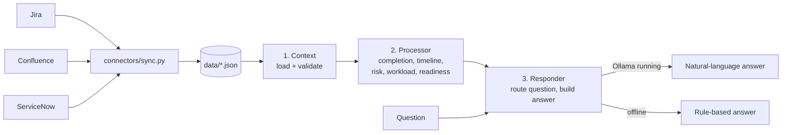

# Release Management Platform

[](https://github.com/mr-taha-saqib/Release-Management-Platform/actions/workflows/ci.yml)


Ask plain-English questions about your releases and get answers built from your real Jira, Confluence and ServiceNow data.

- *"When will this project be finished?"*
- *"Are there any blocked tasks?"*
- *"Who on the team is overloaded?"*
- *"Are we ready to release? What does the CAB say?"*
- *"What should we focus on next?"*

Every number in an answer is computed from the project data; nothing is guessed. When a local [Ollama](https://ollama.com) model is running it phrases the answer in natural language, and when it isn't, a deterministic rule-based engine answers instead, so the tool works fully offline with no API keys.

---

## How it works



**Context** (`mcp/context.py`) loads one project's JSON, validates it and holds it in memory.
**Processor** (`mcp/processor.py`) computes the metrics:
- **Completion and timeline:** completion, remaining effort adjusted by how much past tasks overran their estimates, team capacity, projected finish and buffer to the deadline.
- **Risk level:** LOW to CRITICAL, from blocked tasks, deadline buffer and estimate variance.
- **Workload:** each person's load (overloaded, balanced or under-used).
- **Release readiness:** QA and documentation gaps, the ServiceNow change request and CAB status, a go/no-go call, and history from past releases.

**Responder** (`mcp/responder.py`) matches the question to the right answer (blockers, priorities, workload, release readiness, Confluence notes, summary, risk, timeline) and formats it.

---

## Quick start

```bash
pip install -r requirements.txt

python main.py --demo          # run 5 sample questions against every project
python main.py                 # interactive CLI
python app.py                  # web UI + API at http://localhost:8000 (docs at /docs)
```

The repo ships with four fictional sample projects (`atlas`, `beacon`, `cipher`, `delta`) in `data/`, so it runs immediately. `Release_Management_Platform_Sample_Data_Guide (1).md` describes them.

### Use your own data

```bash
cp .env.example .env        # add Atlassian, Jira, Confluence and ServiceNow settings
python setup_check.py       # verifies credentials and connectivity
python connectors/sync.py   # pulls everything into data/
```

Or call `POST /sync` from the web UI. `CLIENT_SETUP.md` is a step-by-step guide for non-technical users.

### Optional: natural-language answers

Install [Ollama](https://ollama.com), run `ollama pull llama3.2`, and keep it running. The model is set by `OLLAMA_MODEL` in `.env`. `GET /llm-status` shows which backend is active.

---

## API

| Method | Path | Purpose |
|---|---|---|
| `GET` | `/projects` | List available projects |
| `GET` | `/projects/{id}` | Computed metrics for one project |
| `POST` | `/ask` | Ask a question: `{"project_id": "atlas", "question": "Any blockers?"}` |
| `GET` | `/context/{id}` | The plain-text context window the answers are built from |
| `POST` | `/sync` | Refresh data from Jira, Confluence and ServiceNow |
| `GET` | `/confluence/{id}` | Synced Confluence pages for a project |
| `GET` | `/servicenow` | Synced ServiceNow change requests |
| `GET` | `/llm-status` | Which answer backend is active |

---

## Repository layout

```
app.py                 FastAPI app and web UI (static/index.html)
main.py                Interactive and demo CLI
mcp/                   Context -> Processor -> Responder pipeline
connectors/            Jira, Confluence and ServiceNow clients, sync, sample-data uploaders
src/llm_interface.py   LLM backends (Ollama, llama.cpp, Claude API) and a simulator
setup_check.py         Environment and credential checker
data/                  Project, Confluence and ServiceNow snapshots
tests/                 pytest suite
```

---

## Tests

```bash
pip install -r requirements.txt pytest httpx
pytest
```

22 tests cover:
- **Loading:** project loading and input validation (including path-traversal ids).
- **Metrics:** exact metrics on a project with known numbers, i.e. completion, overrun-adjusted remaining effort, capacity, risk escalation for blocked tasks and missed deadlines, and workload balance.
- **Sample data:** consistency checks on all four sample projects.
- **Question routing:** blockers, workload and the summary fallback.
- **API:** the API endpoints.

Ollama is disabled in tests, so the suite runs offline. CI runs it on every push.
